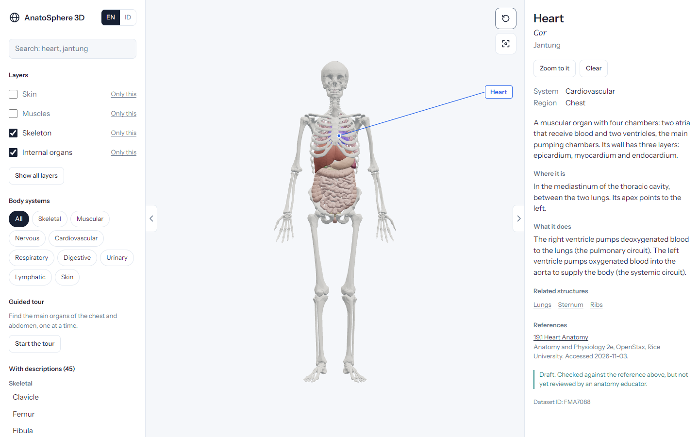

# AnatoSphere 3D

An interactive 3D human anatomy explorer for the web, in English and Indonesian.

**[Open the live app](https://anatosphere-smoky.vercel.app)**

Rotate a full-body model, turn its layers on and off, search for a structure in either language, and read what it does and where the information comes from.



## What it does

- **Four layers:** skin, muscles, skeleton and internal organs, 654 selectable parts in all. Each layer downloads only when it is first shown.
- **45 documented structures** in both languages, each citing a section of OpenStax *Anatomy and Physiology 2e*.
- **Search** across English, Indonesian, Latin names and synonyms. Picking a result hides the layers covering it and moves the camera to it.
- **Guided tour** through seven structures of the chest and abdomen.
- **Desktop, tablet and phone layouts.** Phones get a bottom sheet instead of side panels.

## Content status

This is a learning project, not a medical reference. All anatomy content is a draft that no qualified anatomy educator has reviewed, and the app says so on each page.

The source dataset has gaps. Some major muscles, such as latissimus dorsi and rectus abdominis, are missing, and the lungs show only airways and vessels. The app states these gaps and doesn't fill them with invented shapes. The full list is in [PROVENANCE.md](public/models/body/PROVENANCE.md).

## Run it

Requires Node.js 22.12 or newer.

```sh
npm install
npm run dev              # development server
npm run build            # production build
npm test                 # content and logic tests
npm run test:e2e         # browser tests; requires Chrome
```

Add `?debug` to the URL of a production build to show the performance counter.

The model files are committed, so you don't need the source dataset to run the app. To rebuild them, follow [PROVENANCE.md](public/models/body/PROVENANCE.md#rebuild).

## Tech

React, TypeScript, Vite, three.js with React Three Fiber, Zustand and i18next. Tests use Vitest and Playwright. The model pipeline uses glTF Transform and meshoptimizer.

More detail is in the [product requirements](docs/PRD.md) and the [Phase 1 report](docs/phase1-report.md), which includes test results and known limits.

## License

The application code is under the [MIT License](LICENSE).

The 3D model in `public/models/body/` is under [CC BY-SA 4.0](https://creativecommons.org/licenses/by-sa/4.0/). It is derived from BodyParts3D:

> BodyParts3D, © The Database Center for Life Science licensed under CC Attribution 4.0 International

The modifications and the reason for the share-alike license are recorded in [PROVENANCE.md](public/models/body/PROVENANCE.md).
